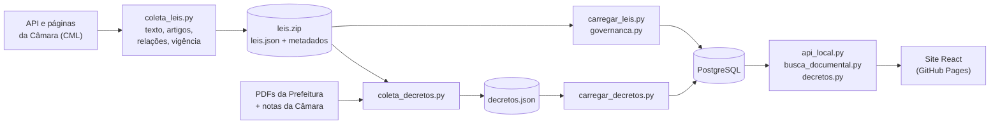

# Londrina Conecta

**As leis de Londrina em linguagem simples, respondidas só com o que está em vigor.**

Projeto do **Hackathon Smart Cities Londrina 2026**. O cidadão ou o servidor faz uma pergunta e recebe a resposta com base nas leis municipais vigentes, citando a lei, o artigo, o decreto que a regulamenta (quando há) e o link oficial.

| | |
|---|---|
| 🌐 **Site** | https://rafapiasentin.github.io/hackathon2026/ |
| ⚙️ **API pública** | https://londrina-conecta-api.vercel.app ([`/api/health`](https://londrina-conecta-api.vercel.app/api/health)) |

---

## Sumário

- [O problema](#o-problema)
- [O que o projeto faz](#o-que-o-projeto-faz)
- [Como funciona](#como-funciona)
- [A base em números](#a-base-em-números)
- [Começando](#começando)
- [Estrutura do repositório](#estrutura-do-repositório)
- [API](#api)
- [Produção e atualização diária](#produção-e-atualização-diária)
- [Testes](#testes)
- [Regras do projeto](#regras-do-projeto)
- [Situação atual e próximos passos](#situação-atual-e-próximos-passos)
- [Documentação](#documentação)

---

## O problema

Londrina tem **mais de 14 mil leis municipais**. Muitas foram revogadas ou alteradas, e a regra que vale hoje costuma estar espalhada em vários atos:

- uma **lei antiga** foi substituída por outra (o Código Ambiental de 2012 foi revogado pelo de 2026);
- um **artigo** teve a redação trocada por uma lei posterior;
- a lei manda regulamentar, e o **decreto** da Prefeitura traz o detalhe (prazo, valor, documento).

Quem consulta só uma parte recebe a informação errada.

## O que o projeto faz

| Funcionalidade | Descrição |
|---|---|
| 💬 **Assistente de perguntas** | Busca só em leis vigentes e artigos não revogados, cita trechos literais (sem inventar) e avisa quando uma lei sobre o assunto foi revogada |
| 🔗 **Lei + decreto na mesma resposta** | Quando um decreto regulamenta a lei, a resposta traz os dois. O botão **"Ver de onde vem esta resposta"** mostra a cadeia lei → alteração → decreto, com avisos |
| 🔎 **Busca de leis** | Por número, ano ou assunto, com filtro por situação |
| 📄 **Página da lei** | Situação (com cor + ícone + texto), histórico de alterações, decretos ligados e texto completo com a redação antiga separada |
| 🔄 **O que mudou** | Compara a lei antiga com a que a substituiu, artigo por artigo |
| ✅ **Validador de leis** | Confere um PDF, imagem ou XML contra a **LC 95/1998** (técnica legislativa), direto no navegador |
| ♿ **Acessibilidade** | VLibras, alto contraste, ajuste de fonte, perguntar falando e ouvir a resposta |

> **Exemplo real:** "quais documentos preciso para a consulta prévia de parcelamento do solo?"
> A **Lei 13.898/2024, Art. 56** diz que um decreto vai regulamentar o tema; o **Decreto 466/2025, Art. 2º** lista os documentos. O sistema responde com os dois e cita cada um.

## Como funciona



1. **Coleta** (`coleta_leis.py`): baixa as 14.308 leis da API oficial da Câmara e a página de cada uma. Separa a redação vigente da antiga (que aparece riscada no site), lê as relações oficiais (quem altera e quem revoga quem) e calcula a situação de cada lei. Gera o `leis.zip` com impressão digital (SHA-256) e totais.
2. **Decretos** (`coleta_decretos.py`): lê as notas que a Câmara escreve nas leis ("Vide Decreto nº…", "Eficácia suspensa pelo Decreto Legislativo…") e o texto dos decretos baixados da Prefeitura. Gera o `decretos.json`.
3. **Carga** (`carregar_leis.py`, `governanca.py`, `carregar_decretos.py`): leva tudo para o PostgreSQL, conferindo impressão digital e totais. A governança registra cada versão e só publica o que passou nas regras.
4. **API** (`api_local.py` + `busca_documental.py` + `decretos.py`): responde às perguntas com busca full-text em português, regras de relevância explícitas (sem IA) e a montagem lei → decreto.
5. **Site** (`frontend/`): React + Vite + TypeScript + Tailwind, publicado no GitHub Pages.

O passo a passo de cada etapa está nos documentos listados em [Documentação](#documentação).

## A base em números

| Item | Quantidade |
|---|---|
| Leis ordinárias coletadas | **14.308** (11.975 vigentes · 1.031 vigentes com alterações · 1.297 revogadas · 5 números vagos) |
| Artigos | **74.630** (1.492 revogados por inteiro, 1.471 com trecho riscado) |
| Relações entre leis | **9.612** |
| Decretos ligados às leis | **120** citados pela Câmara · **222** vínculos · **3** com texto completo |
| Leis com problemas na fonte, tratados e documentados | **1.490** ([lista](docs/PROBLEMAS_NOS_DADOS.md)) |

Coleta de 14/11/2026. Os números exatos ficam em [`leis.meta.json`](leis.meta.json).

## Começando

**Requisitos:** Python 3.12+, Node.js 20+ e, para o caminho completo, PostgreSQL.

| Quero… | Como |
|---|---|
| **Só ver o site com dados de exemplo** | `cd frontend && npm install && npm run dev` |
| **Rodar o site usando a API pública** | Crie `frontend/.env.local` com `VITE_API_URL=https://londrina-conecta-api.vercel.app` e rode o comando acima |
| **Rodar tudo localmente (banco + API + site)** | Siga o [RODAR_LOCAL.md](RODAR_LOCAL.md) |
| **Refazer a coleta das leis** | `python coleta_leis.py --texto` (precisa do token da Câmara no `.env`; ~1h10). Detalhes em [docs/DADOS.md](docs/DADOS.md) |

O site abre em http://localhost:5173. Com o backend local, a API fica em http://127.0.0.1:8000 (documentação interativa em `/docs`).

## Estrutura do repositório

```
├── coleta_leis.py            Coleta das leis na Câmara (texto, relações, vigência)
├── coleta_decretos.py        Vínculos lei → decreto e texto dos decretos
├── decretos.py               Regras dos decretos e montagem da resposta em camadas
├── relatorio_problemas.py    Relatório dos problemas encontrados na fonte
├── carregar_leis.py          Carga do leis.zip no PostgreSQL (confere hash e totais)
├── carregar_decretos.py      Carga do decretos.json
├── governanca.py             Publicação governada (contrato, versões, pendências)
├── banco.py                  Modelos do banco (Peewee)
├── busca_documental.py       Regras de busca e relevância (sem IA)
├── api_local.py              API FastAPI
├── adaptadores.py            Entrada de dados em JSON, CSV, XML, HTML e PDF (com OCR)
├── leis.zip                  Base coletada (leis.json + leis.meta.json)
├── decretos.json             Decretos e vínculos com as leis
├── frontend/                 Site (React + Vite + TypeScript + Tailwind)
├── deploy/                   Publicação da API (Vercel) e worker diário
├── tests/                    Testes automáticos (pytest)
└── docs/                     Documentação detalhada
```

## API

| Método | Rota | O que faz |
|---|---|---|
| `POST` | `/api/perguntar` | Responde a uma pergunta. Devolve `resposta`, `fontes`, `ignoradas` (leis revogadas deixadas de fora), `camadas` (lei → alteração → decretos) e `alertas` |
| `GET` | `/api/leis` | Busca por texto, número (`numero`, `ano`) e `situacao`, paginada |
| `GET` | `/api/leis/{id}` | Uma lei com artigos, relações e decretos ligados |
| `GET` | `/api/health` | Situação do banco, totais, versão da busca e impressão digital da carga |

O contrato completo, com exemplos de JSON, está em [frontend/README.md](frontend/README.md).

## Produção e atualização diária

| Parte | Onde roda |
|---|---|
| Site | **GitHub Pages**, build exportado para a raiz da `main` |
| API | **Vercel** (`londrina-conecta-api`), com credencial do banco só de leitura e modo `documental` |
| Banco | **Neon** (PostgreSQL), projeto `hackathon2026-londrina`, branch `producao` |
| Coleta | **GitHub Actions** (`backend.yml`), todo dia às 03:00 de Brasília: roda todos os testes, coleta as leis e atualiza os decretos |

No GitHub Actions, a ação manual **`validar`** roda os testes e confere se o banco de produção bate com o `leis.zip` do repositório, sem alterar nada. Como publicar cada parte: [deploy/README.md](deploy/README.md).

## Testes

```powershell
python -m pytest -q                                   # testes que não precisam de banco
$env:DB_TEST_NAME = 'hackathon2026_teste'; python -m pytest -q   # inclui os testes com PostgreSQL
```

Os testes cobrem coleta, carga (hash, totais, rollback), governança, busca (com casos reais em `tests/casos_consulta.json`), API, decretos e hospedagem. No GitHub, todos rodam em um PostgreSQL isolado antes de cada coleta.

## Regras do projeto

Valem para qualquer código novo, inclusive gerado por IA:

1. **O identificador de uma lei é o `id` da Câmara.** Número e ano se repetem (existem duas Leis nº 48 de 1949).
2. **Responder só com o que está vigente:** leis `vigente` ou `vigente_com_alteracoes`, artigos com `revogado = false`, usando só o campo `texto`. O `texto_riscado` é histórico.
3. **"Revogada por" nos relacionamentos pode ser revogação parcial.** A revogação total vem da anotação "(REVOGADA pelo …)" na ementa, e precisa citar uma **lei**: decreto não revoga lei.
4. **Nunca inventar dados.** O que falta na fonte fica nulo, com um campo dizendo de onde veio cada informação.
5. **Toda resposta cita lei, artigo e link oficial** e avisa que não substitui orientação jurídica. Sem evidência, o assistente diz que não encontrou.
6. **Toda carga confere o SHA-256 e os totais** do `leis.meta.json`.
7. **Segredos nunca vão para o Git:** token da Câmara e senhas ficam no `.env` ou nas variáveis da hospedagem.

## Situação atual e próximos passos

**Pronto e no ar:** coleta completa · vigência e redação antiga separada · relatório de problemas da fonte · banco com conferência de integridade · governança · busca documental 2.2.0 · decretos ligados às leis (resposta lei + decreto e avisos) · site com validador, comparação e acessibilidade · coleta e testes diários automáticos.

**Próximos passos:**

- [ ] Coletar automaticamente os decretos do Jornal Oficial do Município (hoje cada decreto com texto é incluído à mão em `decretos_fontes.json`)
- [ ] Decidir se a resposta terá um modelo de IA para redigir em linguagem natural, lendo só os artigos encontrados
- [ ] Incluir Lei Orgânica, leis complementares e emendas
- [ ] Ler o texto das 18 leis que só existem em PDF
- [ ] Definir com o órgão o fluxo de revisão institucional de vigência

## Documentação

| Documento | Conteúdo |
|---|---|
| [RODAR_LOCAL.md](RODAR_LOCAL.md) | Rodar banco, API e site na sua máquina |
| [docs/COMO_FUNCIONA.md](docs/COMO_FUNCIONA.md) | O coletor de leis, função por função |
| [docs/DADOS.md](docs/DADOS.md) | Fonte, formato do `leis.json`, cálculo da vigência e problemas da fonte |
| [docs/DECRETOS.md](docs/DECRETOS.md) | Como leis e decretos são ligados e entram na resposta |
| [docs/BANCO.md](docs/BANCO.md) | Tabelas, carga e conferência no PostgreSQL |
| [BUSCA_DOCUMENTAL.md](BUSCA_DOCUMENTAL.md) | Regras da busca e da relevância |
| [GOVERNANCA.md](GOVERNANCA.md) | Entrada de dados e publicação governada |
| [docs/PROBLEMAS_NOS_DADOS.md](docs/PROBLEMAS_NOS_DADOS.md) | Os 1.490 casos da fonte, lei por lei |
| [frontend/README.md](frontend/README.md) | Telas, contrato da API e publicação do site |
| [deploy/README.md](deploy/README.md) | Produção: Neon, Vercel e GitHub Actions |

---

<sub>Projeto do Hackathon Smart Cities Londrina 2026. As respostas são baseadas nas leis publicadas pela Câmara Municipal de Londrina e não substituem orientação jurídica.</sub>
